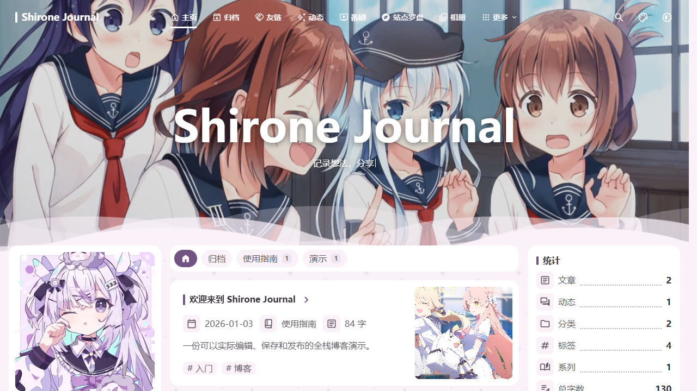
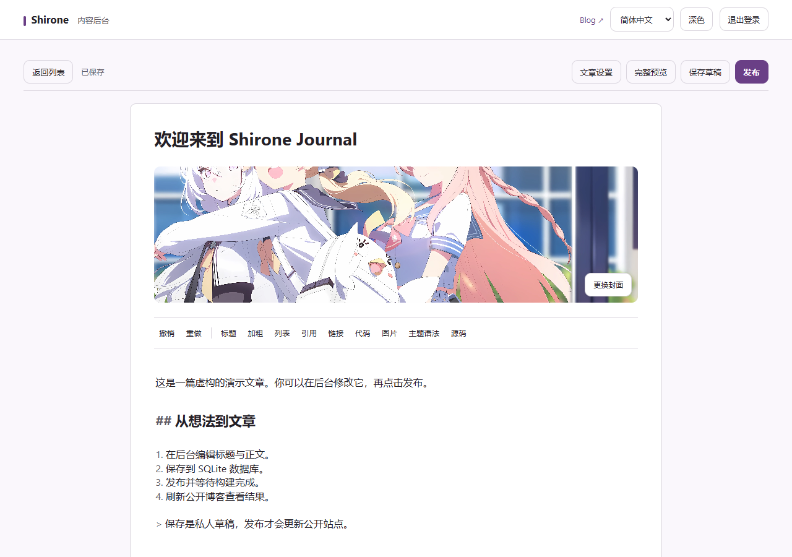

# Shirone Blog Template

基于 Shirone 的全栈博客模板：Astro + Svelte 前台、Node.js 内容后台、SQLite 数据库，以及后台发布到静态站点的完整流程。保留原主题 MIT 许可与作者声明。

所有文章、动态、个人资料均为演示用途；图片保留自 [LyraVoid/Shirone](https://github.com/LyraVoid/Shirone)，详见 [素材来源与校验清单](docs/upstream/README.md)。源码不附带真实数据库、账号密码、密钥、服务器地址或 Git 历史。





## 本地体验

需要 Node.js 22.13+（建议使用 Node 22 LTS）及 pnpm 9.14.4。在项目根目录运行：

```sh
pnpm bootstrap
pnpm build
pnpm demo
```

Windows PowerShell 使用 `pnpm.cmd`。首次安装需要网络；不需要安装独立数据库服务。`bootstrap` 安装前后台依赖并生成后台编辑器、十语言文案和 Markdown 预览资源。

| 入口 | 地址 |
| --- | --- |
| 公开博客 | http://127.0.0.1:4322 |
| 内容后台 | http://127.0.0.1:18490 |
| 私人日记演示 | http://127.0.0.1:18491 |

演示入口自动建立本机会话，仅绑定 `127.0.0.1` 并检查 Host。**这是无密码的本地演示，不能通过公网隧道、反向代理或共享主机开放。** 正式服务仍使用独立的 `server.mjs`、HTTPS 和 OIDC 双因素认证；演示登录代码不进入生产镜像。

体验步骤：

1. 打开后台，查看两篇公开文章、两篇草稿和一条动态。
2. 编辑文章并保存，刷新后台确认数据库持久化。
3. 点击发布；等待发布记录显示成功，再刷新博客。构建可能需要一分钟以上。
4. 未发布的草稿不会出现在公开博客；日记空间不提供发布功能。
5. `Ctrl+C` 停止全部本机服务。重新启动后内容保留在 `.demo/`。

`.demo/` 包含 SQLite、上传图片、日记演示密钥、发布快照与构建结果，**不要上传**。需要重置时先停止演示，再删除这个目录。源码文章不会被后台发布覆盖；失败的构建不会切换当前公开版本。

## 目录

```text
src/                 博客主题、配置及虚构演示内容
public/              静态资源与演示封面
services/authoring/  后台 API、编辑器、SQLite、认证与测试
  demo/              独立的本机演示启动器与发布 worker
deploy/              Linux 生产部署参考与配置占位示例
scripts/             构建、校验、开源打包工具
docs/                架构、部署说明及主题技术文档
tests/               主题测试
```

站点标题、域名等在 `src/config/siteConfig.ts`，个人资料在 `src/config/profileConfig.ts`。音乐和统计默认关闭。演示未启用十语言全站路由，可按需打开；后台支持十种语言。

## 验证与打包

```sh
pnpm test:backend
pnpm exec astro check
pnpm check:manifest
pnpm build
node scripts/release/check.mjs
```

Windows 打包：`powershell -ExecutionPolicy Bypass -File scripts/release/package.ps1`。ZIP 输出到项目同级目录，使用明确的目录白名单，排除依赖、构建产物、运行数据及本机配置。上传 ZIP 中的源码即可，不要上传整份开发目录。

详见 [生产部署](docs/template-deployment.md)、[数据流与边界](docs/template-architecture.md) 和 [交付验证](docs/template-validation.md)。原主题测试中可能存在针对原演示内容的断言，变更演示文章后不能把这些测试当成现有模板的验收结论。
